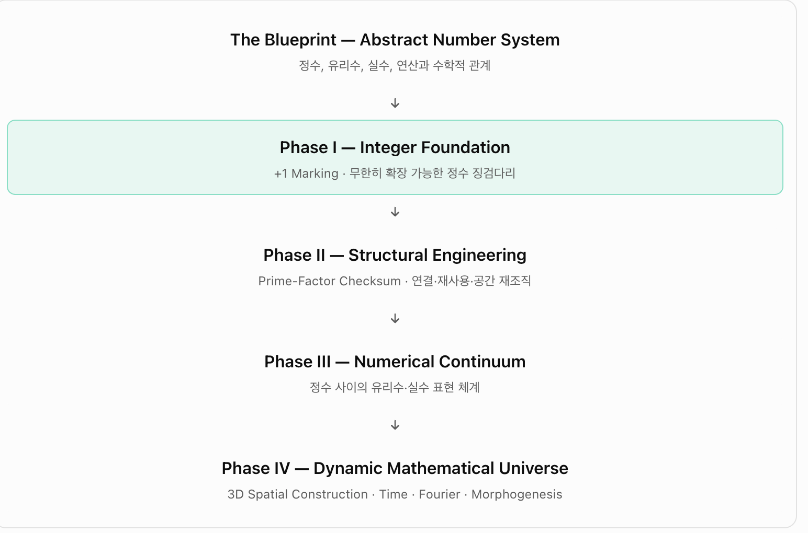

# Team Unicorn · Number-System Universe Engineering

**자기확장적 정수 우주의 생성 원리 / Generative Principles of a Self-Expanding Integer Universe**

Exploratory engineering thought experiment, release **v0.7** (13 October 2026), with **v0.7.1 conceptual and entropy addenda**. Mathematical facts, toy-simulator outputs and speculative hypotheses are kept separate. **Not a proof of a new prime-number law or a physical cosmology.**

## Ultimate purpose — engineering the formation of ideas / 최상위 목적

**EN:** The overarching research question is how **abstract or metaphysical concepts can be created, structured, tested and refined through an engineering approach**. The number-system universe is our deliberately chosen **thought-experiment testbed**, not the final object of study or evidence about how cognition actually works.

**KO:** **추상적·형이상학적 개념이 형성되는 사고 과정을 공학적으로 설계·시험·개정할 수 있는가**가 최상위 연구 질문이다. 수 우주 건설은 그 과정의 **시험대**다. 실제 사고·우주의 법칙을 증명했다고 주장하지 않는다.

- **[한국어: 사고의 공학 연구 목적 선언](docs/ko/Thought_Engineering_Charter_v0.7.1_KO.md) / [English charter](docs/en/Thought_Engineering_Charter_v0.7.1_EN.md)**
- **[한국어: 엔트로피·정보 관리 프로토콜](docs/ko/Entropy_Management_v0.7.1_KO.md) / [English entropy protocol](docs/en/Entropy_Management_v0.7.1_EN.md)**

## Engineering testbed / 수 우주 구현 사고실험

**EN:** Engineer an efficient spatial representation of the *already-defined abstract number system*. Phase I is a continually extensible sequence of **integer stepping-stone markers**. Team Unicorn builds those integer markers; unicorns **do not hunt primes**. Prime factorisation is an optional constructive verification/management tool; its significance must emerge from controlled tests.

**KO:** 이미 수학적으로 존재하는 **추상적 수 체계 전체를 공간적으로 구현**하는 공학적 사고실험이다. Phase I은 **무한히 확장 가능한 정수 징검다리 기초공사**다. 유니콘의 임무는 소수를 찾는 것이 아니라 정수 돌을 하나씩 놓는 것이다. 소인수분해는 건설·검증에 활용할 수 있는 도구이며 연구의 목적이 아니다.

## Whole blueprint / 전체 청사진

| Layer | Primary work |
|---|---|
| **Blueprint: Abstract Number System** | Integers, rationals, reals, operations and relations |
| **Phase I: Integer Foundation** | Successor `+1` marking: an unbounded integer stepping-stone scaffold |
| **Phase II: Structural Engineering** | Prime-factor checksum, inherited certification, links, reuse and retrospective spatial relayout |
| **Phase III: Numerical Continuum** | Addressable rational and real intervals; explicit representation and completion rules are still required |
| **Phase IV: Dynamic Mathematical Universe** | 3D spatial construction, time, Fourier dynamics, feedback, self-propagation and morphogenesis |

These are **interdependent engineering layers, not strictly sequential historical phases**: I, II and IV begin together.

## Documents

| Document | Korean | English |
|---|---|---|
| Number-System Universe Blueprint | [KO DOCX](docs/ko/Number_System_Blueprint_v0.7_KO.docx) · [PDF](docs/ko/Number_System_Blueprint_v0.7_KO.pdf) | [EN DOCX](docs/en/Number_System_Blueprint_v0.7_EN.docx) · [PDF](docs/en/Number_System_Blueprint_v0.7_EN.pdf) |
| Research Proposal v0.7 | [KO DOCX](docs/ko/Team_Unicorn_v0.7_Proposal_KO.docx) · [PDF](docs/ko/Team_Unicorn_v0.7_Proposal_KO.pdf) | [EN DOCX](docs/en/Team_Unicorn_v0.7_Proposal_EN.docx) · [PDF](docs/en/Team_Unicorn_v0.7_Proposal_EN.pdf) |
| Technical & Simulation Status v0.7 | [KO DOCX](docs/ko/Team_Unicorn_v0.7_Technical_Report_KO.docx) · [PDF](docs/ko/Team_Unicorn_v0.7_Technical_Report_KO.pdf) | [EN DOCX](docs/en/Team_Unicorn_v0.7_Technical_Report_EN.docx) · [PDF](docs/en/Team_Unicorn_v0.7_Technical_Report_EN.pdf) |

## Simulations (preserved historic experiments; not one unified validated simulator)

| Version | Location | Notes |
|---|---|---|
| 0.2 | [`simulations/gait-0.2`](simulations/gait-0.2/) | Time horizons; hypothetical stride × frequency; management queue |
| 0.3 | [`simulations/gait-0.3`](simulations/gait-0.3/) | Destination-aware Unicorns 2–100; prime-label=stride **toy assumption** |
| 0.4 | [`simulations/gait-0.4`](simulations/gait-0.4/) | Fourier phase/frequency toy gait and *separate* exact divisibility filter |
| 0.5 | [`simulations/gait-0.5`](simulations/gait-0.5/) | Unchanged 0.4 model scaled to 1,000,000 destinations; 100K CSV + compressed 1M CSV |
| 0.6 | [`simulations/gait-0.6`](simulations/gait-0.6/) | Phase disturbance, feedback-controller toy dynamics |
| 0.6.1 | [`simulations/gait-0.6.1`](simulations/gait-0.6.1/) | Separate cost assigned to leg coordination |

Most HTML simulations are self-contained and can be opened from disk. Python tests are preserved from their original research archives, including previous assumptions; they are **not** all self-standing installation packages.

## Key distinctions

- Leg **count** can be any optimised positive integer; individual prime-labelled legs do not mean the gait is prime-driven or that primes are destinations.
- A placed integer marker makes `[n,n+1]` *addressable* in the conceptual plan. This does **not** generate a real continuum.
- `+1` placement and inherited prefix checksum are **separate construction duties**. Integer values are invariant while 3D layout/caches may be reorganised.
- The most important next test is **reusing full-prefix integer certification rather than recomputing it** and assessing cost together with known-destination feedback.
- The speculative wave/phase–prime link is not established by existing toy simulations. Include shuffled/composite-label controls.

## Entropy and information management (v0.7.1)

- **Spatial-configuration entropy** and **HQ design uncertainty** are distinct Shannon quantities and each requires an explicit probability model.
- **Representation length, memory/certificate reuse, logical erasure and computational time** are separately measurable proxies.
- **Thermodynamic entropy production** cannot be read from these toy simulations; physical apparatus and energy accounting would be required.
- **Coordination cost is not entropy.** Gait Lab 0.6.1 has a coordination penalty, not an entropy meter. Future experiments will compare inherited/cached full-prefix certification with recomputation.
- Full experimental definitions and falsification controls: [KO](docs/ko/Entropy_Management_v0.7.1_KO.md) · [EN](docs/en/Entropy_Management_v0.7.1_EN.md).

## Provenance, release boundaries & licensing

- Sources: 2024 unicorn/footprint discussion, user-supplied 2026-10-13 blueprint, and Team Unicorn research conversations/experiments through 2026-10-13. **v0.7 PDF/DOCX are preserved historical documents; the v0.7.1 Markdown addenda supersede their framing but do not overwrite them.**
- The user's **private Canon DB, private correspondence, personal screenshots and credential files are intentionally excluded**. The one included screenshot is the supplied project blueprint.
- No software licence is assigned without the project owner's selection. Do not infer a blanket reuse licence from public repository visibility.
- The historical experimental files are preserved as research records: comments and results should be interpreted under their original stated assumptions, not v0.7 claims.
